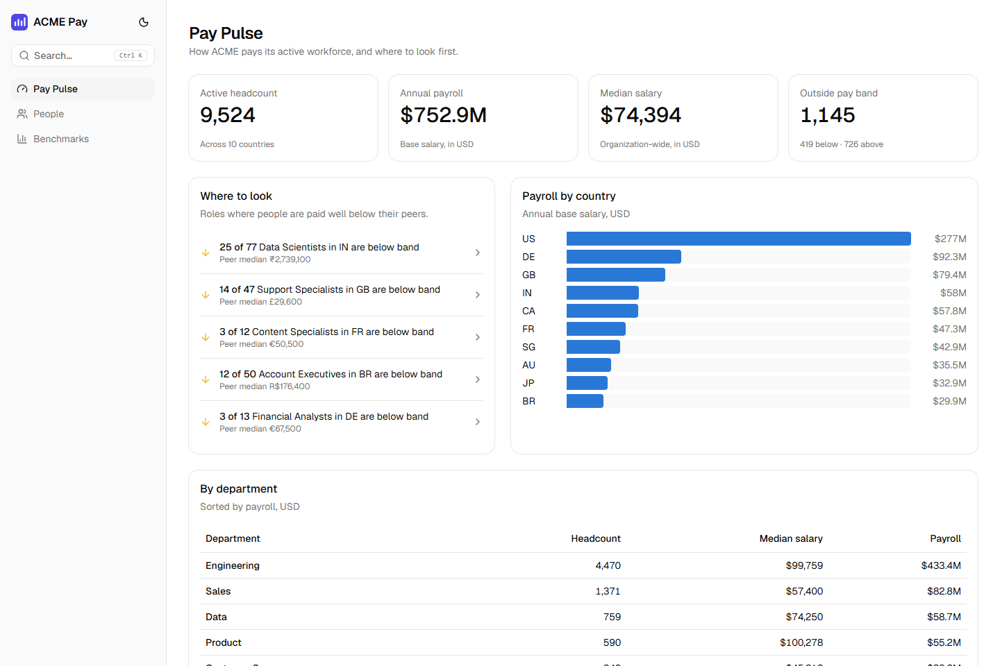
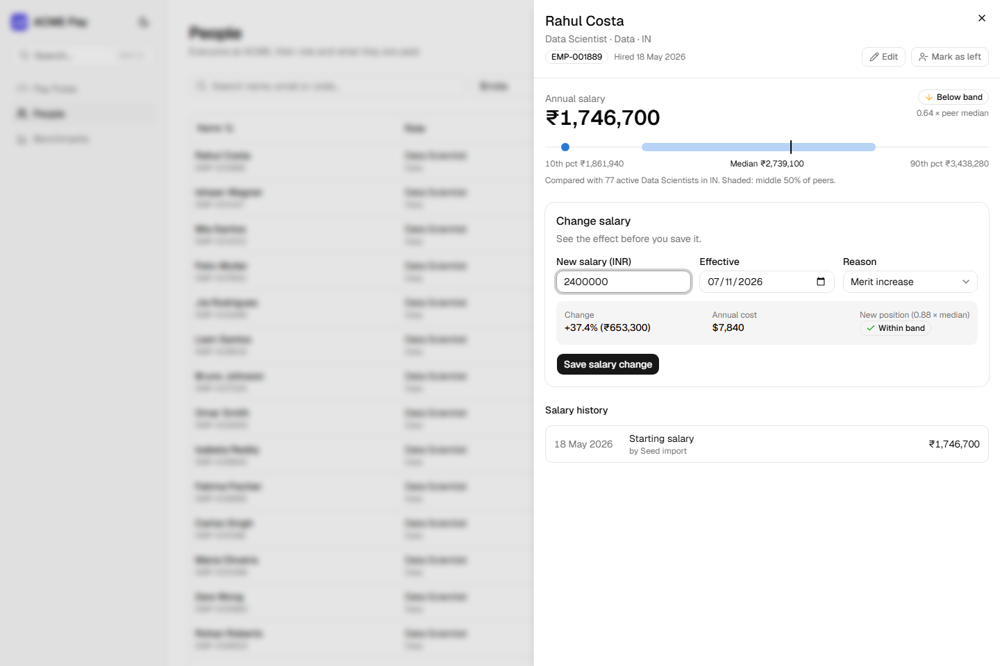
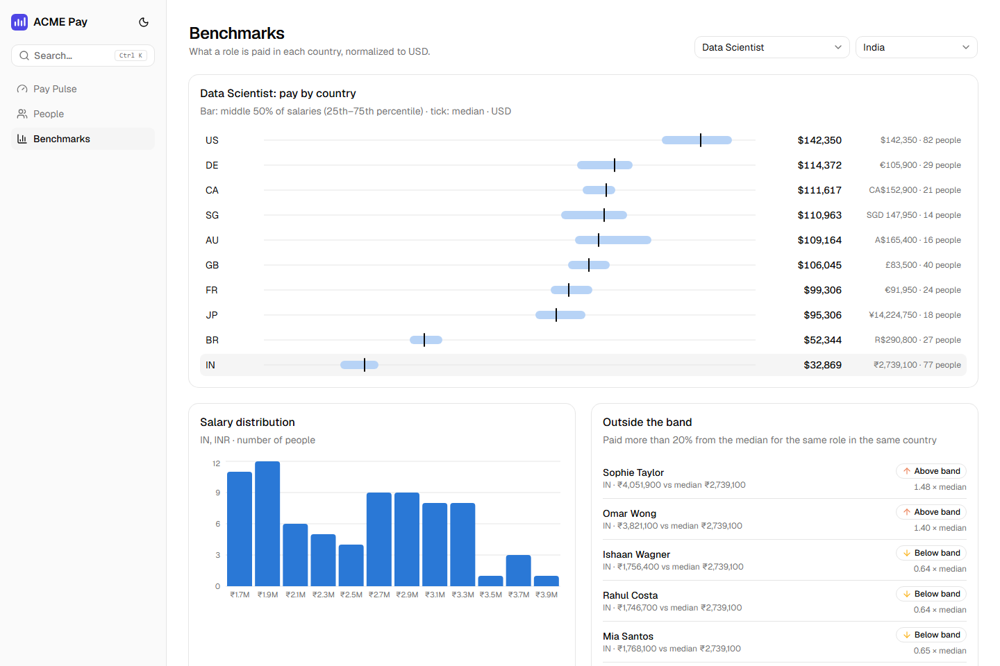

# ACME Pay

**Insight-first salary management for HR.** ACME Pay replaces spreadsheet-based pay management for a 10,000-person, multi-country organization. The HR manager can see how the company pays people, change salaries with their consequences shown first, keep a complete pay history, and ask pay questions in plain English, with the data behind every answer.

**Live:** https://acme-pay-hiten.vercel.app · **API docs:** https://acme-pay-hiten.vercel.app/api/docs · *Synthetic data only.*



## What it does

| Job to be done | How ACME Pay helps |
|---|---|
| **See where pay needs attention** | *Pay Pulse* shows headcount, payroll and median in USD, how many people sit outside their pay band, and *where to look*: peer groups with people paid well below their colleagues. |
| **Decide a raise with confidence** | The profile shows where someone sits among peers (same role, same country). Typing a new salary previews the new band position, % change and annual USD cost **before** saving. |
| **Keep pay data correct** | Validated create, edit and leave flows. Every salary change is recorded with its previous value, reason, date and author, and history is never overwritten. |
| **Compare a role across countries** | *Benchmarks*: middle 50% and median per country in USD, the salary distribution, and the people furthest outside the band. |
| **Find anyone fast** | Search, filters and sorting held in the URL (shareable), `Ctrl/⌘ K` palette, CSV export for Excel. |
| **Ask instead of dig** | *Ask ACME Pay*: a grounded AI analyst that can only use tested, aggregate-only queries. It never sees individuals and never writes SQL ([ADR 0007](docs/adr/0007-grounded-ai-pay-analyst.md)). Optional; enabled by a free Gemini key. |

| Raise preview | Benchmarks |
|---|---|
|  |  |

## How it is built
**Backend:** Python 3.13, FastAPI, SQLAlchemy 2 (async), Alembic, PostgreSQL 17 (Neon). **Frontend:** React 19, TypeScript, Vite, TanStack Router and Query, shadcn/ui, Tailwind v4. **Delivery:** GitHub Actions to Vercel. All on free tiers.

- **Money is exact:** a `Money` value object (Decimal plus currency) that refuses to mix currencies, `NUMERIC` in the database, decimal strings over the API, and dated FX rates for USD views ([ADR 0006](docs/adr/0006-money-and-currency.md)).
- **Analytics in SQL:** medians and percentiles via `percentile_cont`, next to the data. Every endpoint is under 200 ms p95 on the 10k dataset ([performance](docs/performance.md)).
- **One contract:** the frontend's API types are generated from the backend's OpenAPI schema, and CI fails on drift.
- **Layered, feature-sliced code:** router → service → repository, with pure domain rules ([architecture](docs/architecture.md)).
- **Tested where it matters:** property-based tests for money and pay rules, integration tests against real PostgreSQL with a rollback per test, AI guardrail tests and golden-question evals, and component tests (154 in total). Backend coverage is 93%; the gap is the live-eval runner and the seed CLI, which are run by hand.

## Read this first
| Document | What it tells you |
|---|---|
| [Requirements (one page)](docs/requirements.md) | Goal, scope, and what's deliberately left out |
| [Plan](docs/PLAN.md) | Product vision, architecture and roadmap, as written before coding |
| [Architecture decisions](docs/adr/) | Why each choice was made, and what changed during delivery ([0009](docs/adr/0009-delivery-refinements.md)) |
| [Architecture](docs/architecture.md) · [Performance](docs/performance.md) | How it fits together; measured timings |
| [How AI was used](docs/ai/) | The rules, key prompts, and AI output that was corrected in review |
| [Demo script](docs/demo-script.md) | The 3-minute walkthrough |

The **commit history** is the build log: test-first commits (`test:` before `feat:`) for every rule and endpoint.

## Run locally
Prerequisites: Python 3.13 and [uv](https://docs.astral.sh/uv/), Node.js 24+, Docker.

```bash
cp .env.example .env                    # optional: add GEMINI_API_KEY to enable the AI analyst
docker compose up -d                    # PostgreSQL 17

cd backend
uv sync
uv run alembic upgrade head             # create the schema
uv run python -m acme_pay.seed          # 10,000 employees in ~4 s
uv run uvicorn acme_pay.main:app        # API on http://localhost:8000 (docs: /api/docs)

cd ../frontend                          # in a second terminal
npm install
npm run dev                             # app on http://localhost:5173
```

### Checks
| | Backend (`backend/`) | Frontend (`frontend/`) |
|---|---|---|
| Lint / format | `uv run ruff check .` · `uv run ruff format .` | `npm run lint` · `npm run lint:fix` |
| Types | `uv run mypy` | `npm run typecheck` |
| Tests | `uv run pytest` (needs Postgres) · `-m "not integration"` without | `npm test` |
| Other | `uv run alembic check` · `uv run python -m acme_pay.assistant.evals` (live AI evals) | `npm run api:generate` (after API changes) · `npm run build` |

## Deployment
Every push to `main` runs all checks, migrates the Neon database, deploys the API and web app to Vercel, and smoke-tests `/api/health` through the public domain. Production data is (re)seeded by the manual **Seed production** workflow. See [ADR 0004](docs/adr/0004-hosting-vercel-github-actions.md).

## Deliberately not included
Authentication (one persona and synthetic data; the seam is ready, [ADR 0008](docs/adr/0008-no-authentication-in-v1.md)), payroll processing, live FX rates, Excel import, and bonus or equity. The reasoning is in the [requirements](docs/requirements.md).
