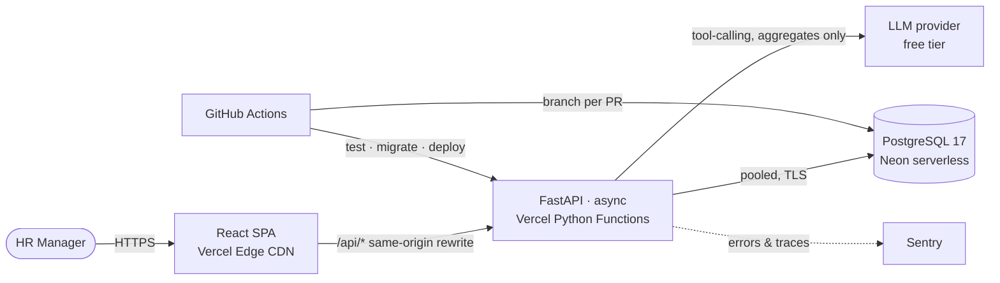
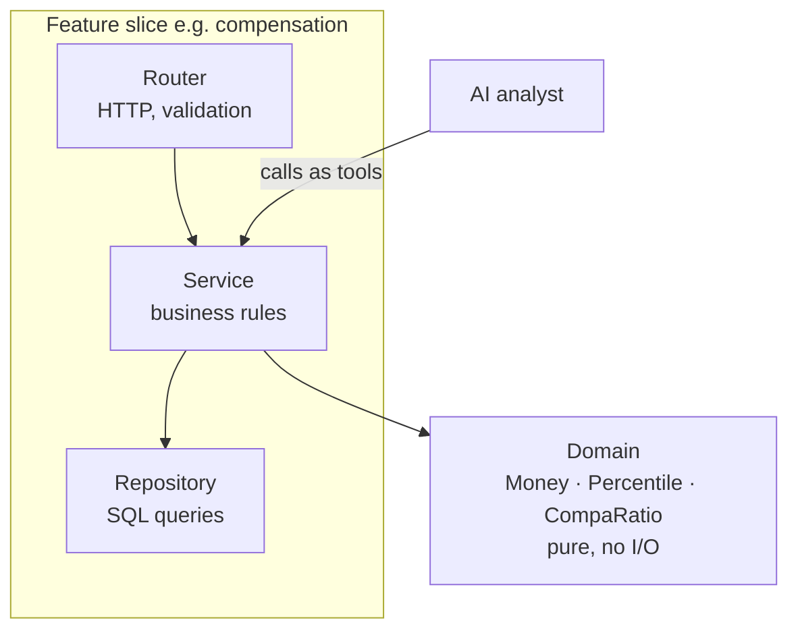
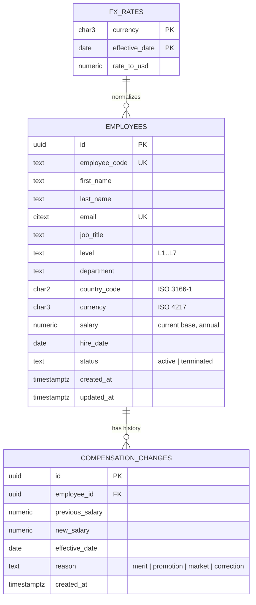
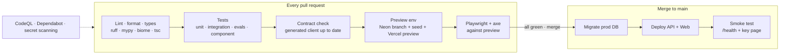

# ACME Pay: Product & Engineering Plan

> **Status:** approved and delivered. This document is kept as written before coding; what changed during delivery, and why, is in [ADR 0009](adr/0009-delivery-refinements.md).
> **Owner:** Hiten Koli · **Last updated:** 2026-11-07

---

## 1. Vision

> **Give the HR manager a clear view of how ACME pays its 10,000 people, and the confidence to change it.**

Most HR systems are record-keeping tools: they store rows, and the user does the thinking. ACME Pay starts from the other end. It shows what matters first (where pay is uneven, what a role is worth in each country, what a raise will cost) and keeps editing a record to one click.

### Product principles
1. **Insight first, data entry second.** The home screen shows what the data says, not a spreadsheet.
2. **Numbers you can trust.** Exact money arithmetic, dated currency rates, an append-only history, and every number traceable to its source.
3. **Ask, don't dig.** HR asks questions in plain English and gets answers backed by real data, with the source numbers shown.
4. **Simple system, polished experience.** The sophistication goes into the user experience and the code quality, not the infrastructure. Ten thousand rows don't need microservices.
5. **Free to run.** Every service used is on a permanent free tier.

---

## 2. Problem

ACME's HR team manages salaries for **10,000 employees in several countries** in Excel.

| Pain | Consequence |
|---|---|
| Copies of files get emailed around | No single source of truth, and nobody trusts the numbers |
| Edits overwrite the old value | No answer to "what did they earn before, and why did it change?" |
| Every question means pivot tables | Simple questions take hours, so they rarely get asked |
| Salaries in many currencies | Comparing across countries is manual and error-prone |
| Free-text cells | Typos, duplicates, and invalid data |

### Persona: Priya, HR Manager
- Fluent in Excel, not technical. Short on time. Accountable to leadership for pay decisions.
- **Jobs to be done:**
  1. *Keep pay data correct*: add people, record raises, and offboard.
  2. *Answer questions about pay*: "Are we paying our engineers in India fairly compared to Germany?"
  3. *Decide with confidence*: "If I give this person 8%, where do they land against their peers, and what does it cost?"

### Success measures (how we would know it works)
- **Under 10 seconds** to answer any of the core pay questions, compared with tens of minutes in Excel.
- **Every** salary change has an author, a date, a reason, and the previous value.
- **Zero** money arithmetic in floating point. Every number reconciles to the database.

---

## 3. The product experience

This is a modern analytics product in the style of Linear, Vercel, or Pave, not a grid of rows with an edit button.

### 3.1 Pay Pulse (home)
An overview of the whole organization in about five seconds.
- **KPI tiles** with trends: headcount, annual payroll (USD), median salary, and the number of people outside their pay band.
- **World payroll map:** countries shaded by payroll. Click a country to drill in.
- **Signals feed** that tells HR where to look, for example *"14 Senior Engineers in India are below the 10th percentile of their peers"* or *"Sales in Brazil saw the largest pay drift this year"*.

### 3.2 Ask ACME Pay (AI pay analyst)
A question box, also on **⌘K**, where HR types things like:
> *"What's the median salary for Data Scientists in Germany vs the UK?"*

The answer comes back as a **short sentence plus an evidence card** (chart and table) with the actual figures from the database.
- **Grounded by design:** the model **cannot write SQL or read employee records**. It can only call a small set of typed analytics tools, the same tested services the dashboard uses. Every number shown comes from the database, never from the model.
- **Private by design:** only the question and **aggregates** are sent to the model. Names, emails, and individual salaries never leave the system.
- **Fails safe:** if the AI is unavailable or not configured, the feature hides itself and everything else works as normal.

### 3.3 People Explorer
Finding people fast, without a 10,000-row spreadsheet.
- **Command-style search** with filter chips (country, department, role, band position) and **saved views** such as "Below band · Engineering".
- **Virtualized list** that scrolls smoothly through 10k rows, with sticky headers and density options.
- **Profile side panel:** opens in place, so HR never loses their position in the list.

### 3.4 Employee profile
- **Pay position bar:** shows where this person sits among peers with the same role and country (10th, 25th, 50th, 75th, and 90th percentile), with their **compa-ratio**: their salary divided by the median for that role and country.
- **Salary timeline:** a step chart of every change, with reasons.
- **Change compensation with a live impact preview:** while HR types a new amount, the panel shows the new band position, the change in annual cost (local currency and USD), and a warning if the new amount falls outside the normal range. HR sees the consequence before saving.

### 3.5 Benchmarks
- **Role × country ranges:** range plots comparing one role across countries in USD, with each country's 25th-to-75th percentile band and median.
- **Distribution:** a salary histogram per country and department.

### 3.6 Craft details
Dark and light themes · keyboard-first navigation · skeleton loading states · optimistic updates · subtle motion · formatting by locale and currency · WCAG 2.2 AA accessibility · works on a laptop and a tablet.

---

## 4. Scope

### In scope
| Capability | Notes |
|---|---|
| Pay Pulse dashboard | KPIs, map, signals |
| Ask ACME Pay | Grounded AI analyst; optional; uses a free-tier LLM |
| People Explorer | Search, filters, saved views, virtualized list, CSV export |
| Employee lifecycle | Create, edit, terminate (soft delete, history kept) |
| Compensation changes | Effective date, reason, live impact preview, append-only history |
| Benchmarks | Percentiles, compa-ratio, distributions, cross-country USD comparison |
| Seed | Deterministic set of 10,000 realistic employees, generated in seconds |

### Deliberately left out
| Left out | Reason |
|---|---|
| **Authentication and roles** | One persona and synthetic data. Reviewers should reach the product without a login wall. The API has a single security dependency where real auth (OIDC) plugs in. *(Your decision, see section 13.)* |
| **Payroll processing** | Tax, payslips, and payments are a separate regulated domain. This product manages and understands salary data; it doesn't pay it out. |
| **Live FX rates** | They would make figures non-reproducible. A **dated** FX table keeps numbers explainable and audit-ready. |
| **Excel import** | Robust import (validation, previews, error reports) is a feature in its own right. It's the first v2 candidate. Export covers the Excel habit today. |
| **Bonus, equity, benefits** | Base salary answers the core questions. The model extends to total compensation later. |
| **Approval workflows, org chart** | Valuable at enterprise scale, but not needed to solve the stated problem. |
| **Pay-equity (gender) analysis** | Highly relevant because the EU Pay Transparency Directive applies from 2026, but it needs sensitive attributes. Stretch goal. |

---

## 5. Architecture

### 5.1 System view



Two deployable units, one database, and no servers to manage.

### 5.2 Backend: hexagonal-lite, feature-sliced



- **Domain:** pure, framework-free types and rules (`Money`, `CurrencyCode`, `CompaRatio`, `PayBand`). They're tested exhaustively with property-based tests.
- **Services:** the use cases. The dashboard, the API, and the AI analyst all call these same services, so there is **one implementation of every business rule** (DRY).
- **Repositories:** the only place that knows SQL. Aggregates run in Postgres, close to the data.

### 5.3 Technology decisions

Each decision becomes an ADR in `docs/adr/`, with context, options, decision, and consequences.

| Area | Choice | Why this | Why not the alternatives |
|---|---|---|---|
| **API** | **FastAPI** (async) · Python 3.13 · **Pydantic v2** | The types *are* the validation and the docs. Async suits streaming AI responses. Mature and fast. | **Django/DRF:** admin, templates, and sessions would go unused, with extra serializer boilerplate. **Flask:** no native typing or validation. **Litestar:** strong, but a smaller ecosystem and fewer people know it. |
| **Data access** | **SQLAlchemy 2.0** (typed, async) · **Alembic** | Typed queries, real SQL when needed, migrations versioned in git. | **SQLModel:** convenient, but limited for analytics queries. **Raw SQL:** no types and no migrations. |
| **Database** | **PostgreSQL on Neon** | `percentile_cont` gives medians and percentiles in SQL. `NUMERIC` stores money exactly. **Copy-on-write branching** gives every PR its own database. Persistent, scales to zero, same engine everywhere. | **SQLite:** no percentiles, a single writer, and free hosts give it ephemeral disks, so edits vanish. **Supabase:** pauses after 7 idle days and ships a whole platform we would not use. **PlanetScale:** no free tier. |
| **Hosting** | **Vercel** (Hobby): SPA on the CDN, API as Python Functions | About a 1-second cold start, a preview URL per PR, HTTPS, and the same origin for the web app and API (no CORS). | **Render free:** around a 50-second cold start after idle. **Fly.io / Railway:** no free tier. **Cloud Run:** needs a card. **Netlify:** weaker Python support. |
| **Frontend** | **React 19 · TypeScript (strict) · Vite** | An internal analytics tool doesn't need SSR or SEO. Vite is the modern default with a fast feedback loop. | **Next.js:** its server layer would be a second backend and blur where business logic lives. |
| **Routing** | **TanStack Router** | Fully type-safe routes and **typed URL search params**, so filters and saved views are shareable URLs. | **React Router:** search params are untyped strings. |
| **Server state** | **TanStack Query** | Caching, background refresh, optimistic updates, and loading and error states as standard. | **Redux:** solves client-state problems we don't have. |
| **UI system** | **shadcn/ui** (Radix primitives) · **Tailwind CSS v4** | The current standard for polished, accessible interfaces. We own the components, so no fighting a library's look. Radix covers accessibility. | **MUI / Ant Design:** a recognizable "admin template" look and heavy bundles. **Mantine:** good, but less control over the visual identity. |
| **Data grid** | **TanStack Table + TanStack Virtual** | Headless and fast. Virtualization keeps 10k rows smooth. | **AG Grid / MUI X:** heavy, and the best features are paid. |
| **Charts and map** | **Recharts** (through shadcn charts) · **d3-geo** with TopoJSON | Charts that match the theme. The world map adds only a few KB and no heavy map library. | **ECharts:** large bundle with a different look. **Mapbox:** API keys and usage limits. |
| **Command palette** | **cmdk** | The ⌘K pattern familiar from Linear and Raycast. | — |
| **Type-safe API client** | **OpenAPI → `@hey-api/openapi-ts`** (types + TanStack Query hooks + Zod) | **One source of truth across the stack.** If the API changes, the frontend fails to compile, and CI blocks the drift. | Hand-written types and fetch calls, which go stale silently. |
| **AI analyst** | **Provider-agnostic port** · default: a free-tier LLM with tool calling (Google Gemini Flash, confirmed at setup) | Free for the assessment. The adapter design lets us switch to any provider (Claude, OpenAI) by changing configuration. | Hard-wiring one vendor. Text-to-SQL, which is unsafe, unpredictable, and leaks data. |
| **Observability** | **Sentry** (free) · structured JSON logs · request IDs | Production errors and traces with no infrastructure to run. | Self-hosted OpenTelemetry stack: real operations work for a 10k-row app. |
| **Python tooling** | **uv · Ruff · mypy --strict · pytest · Hypothesis** | Fast, lockfile-based, strict. Hypothesis proves money and statistics invariants. | pip, flake8, Black, isort: slower and fragmented. |
| **Web tooling** | **Biome** (lint + format) · **Vitest · Testing Library · MSW · Playwright + axe** | Biome is a single fast tool. Playwright with axe tests real flows and accessibility. | ESLint + Prettier: two tools and slower. Jest: friction with Vite. |
| **CI/CD** | **GitHub Actions** + Neon branching + Vercel CLI | Free. Deploys are gated by checks. Every PR gets a full-stack preview. | Vercel git auto-deploy alone, which can ship code that hasn't passed checks. |

### 5.4 Design decisions in the code
- **Money is a value object:** `Money(amount: Decimal, currency: CurrencyCode)`. It's `NUMERIC(14,2)` in the database and **never a float**. Arithmetic across currencies is a type error unless converted explicitly through a dated FX rate.
- **Currency normalization:** an `fx_rates` table (currency, rate to USD, effective date). Every USD figure in the UI shows its rate date.
- **Append-only compensation history:** the current salary is stored on `employees` for fast reads, and every change writes to `compensation_changes` **in the same transaction**. Fast directory queries and a complete audit trail.
- **Derived, not stored:** percentile and compa-ratio are computed from peer groups (role × country) at query time. There's no second copy of the truth to keep in sync.
- **Soft delete:** terminated employees keep their history. Analytics include active employees only.
- **Errors:** **RFC 9457 Problem Details** everywhere, mapped to friendly UI messages.
- **Pagination:** cursor-based (keyset) for the list, which stays fast and consistent while data changes, with total counts from a single aggregate.
- **Indexes are justified:** each index is backed by an `EXPLAIN ANALYZE` result in `docs/performance.md`.

### 5.5 Data model



### 5.6 API surface (`/api/v1`, OpenAPI 3.1)

| Endpoint | Purpose |
|---|---|
| `GET /employees` | Search, filters, sort, cursor pagination |
| `POST /employees` · `GET / PATCH /employees/{id}` | Lifecycle |
| `POST /employees/{id}/terminate` | Soft delete |
| `GET / POST /employees/{id}/compensation` | History and new change |
| `POST /employees/{id}/compensation/preview` | **Impact preview** (computed, not saved) |
| `GET /employees/export.csv` | Export with the same filters as the list |
| `GET /insights/pulse` | KPIs, per-country payroll, signals |
| `GET /insights/benchmarks` | Percentiles for role × country (USD or local) |
| `GET /insights/distribution` | Histogram buckets |
| `GET /insights/outliers` | People outside the 10th-to-90th percentile range of their peer group |
| `POST /assistant/ask` | AI analyst, streamed (SSE): answer + evidence |
| `GET /meta/options` · `GET /health` | Dropdown values · liveness and DB check |

---

## 6. Quality strategy

### 6.1 Test pyramid

| Layer | Tooling | What it proves | Speed |
|---|---|---|---|
| **Domain (property-based)** | pytest + **Hypothesis** | Money never loses precision; percentiles stay within min and max; compa-ratio of the median is 1.0 | ms |
| **Service (unit)** | pytest, in-memory fakes | Business rules: change history, termination, preview math | ms |
| **API + DB (integration)** | pytest + real Postgres, **transaction rollback per test** | Queries, constraints, HTTP contract | ~1 s total |
| **AI analyst (evals)** | **Golden question set** with a recorded LLM in CI | Each question maps to the right tool and arguments; answers cite real numbers | ms in CI (recorded) |
| **Frontend (component)** | Vitest + Testing Library + **MSW** | Components behave correctly against a realistic mocked API | ms |
| **End-to-end** | **Playwright + axe** | Key journeys work in a real browser, with no accessibility violations | ~1 min |

Every test is **deterministic**: fixed seeds, frozen time, and no network in unit tests.

### 6.2 Non-functional budgets (enforced or measured)
| Metric | Budget |
|---|---|
| API p95 latency, warm (list, insights) | < 200 ms |
| Largest Contentful Paint (Pay Pulse) | < 2.0 s |
| Initial JS bundle (gzipped) | < 250 KB |
| Seed 10k employees | < 10 s |
| Accessibility | 0 axe violations on key pages |

---

## 7. Repository structure

```
acme-pay/
├── .github/
│   ├── workflows/
│   │   ├── ci.yml                 # checks on every push & PR
│   │   ├── preview.yml            # per-PR Neon branch + Vercel preview
│   │   ├── release.yml            # main → migrate → deploy → smoke test
│   │   └── seed.yml               # manual, idempotent production seed
│   └── dependabot.yml
├── backend/
│   ├── pyproject.toml             # uv · ruff · mypy · pytest config
│   ├── uv.lock
│   ├── migrations/                # Alembic
│   ├── acme_pay/
│   │   ├── main.py                # app factory
│   │   ├── core/                  # config, db, errors, logging, security seam
│   │   ├── domain/                # Money, CompaRatio, Percentile (pure)
│   │   ├── employees/             # router · schemas · service · repository · models
│   │   ├── compensation/          # history, preview
│   │   ├── insights/              # pulse, benchmarks, outliers
│   │   ├── assistant/             # LLM port, adapters, tool registry, prompts
│   │   └── seed/                  # deterministic generator + bulk loader
│   └── tests/
│       ├── domain/  unit/  integration/  evals/
│       └── conftest.py
├── frontend/
│   ├── package.json · vite.config.ts · biome.json · vercel.json
│   ├── openapi-ts.config.ts       # generates the typed API client
│   └── src/
│       ├── routes/                # TanStack Router (file-based)
│       ├── features/
│       │   ├── pulse/  people/  profile/  benchmarks/  assistant/
│       ├── components/ui/         # shadcn/ui primitives (owned)
│       ├── lib/                   # formatters (money, dates), utils
│       ├── api/                   # GENERATED client, never edited by hand
│       └── styles/                # Tailwind theme tokens
│   └── e2e/                       # Playwright journeys
├── docs/
│   ├── PLAN.md                    # this document
│   ├── requirements.md            # one-page requirements (assessment ask)
│   ├── architecture.md            # C4 context/container + request flows
│   ├── performance.md             # measurements, EXPLAIN plans, scaling path
│   ├── adr/                       # 0001-record-architecture-decisions.md …
│   └── ai/                        # rules, prompts, AI-corrections log
├── docker-compose.yml             # local Postgres 17
├── CLAUDE.md                      # project rules for the AI pair-programmer
└── README.md                      # pitch · live demo · video · run in 3 commands
```

**Why this shape:** both apps are **sliced by feature**, so everything about "compensation" lives together and changes in one place. Inside each slice, dependencies point inward (router → service → domain), so business rules never depend on HTTP, the database, or the UI. The generated API client is isolated and never edited by hand. The docs are first-class because the thinking matters as much as the code.

---

## 8. Delivery pipeline



- **Every PR gets its own full-stack environment:** an instant Neon database branch, seeded with the 10k dataset, plus a Vercel preview URL. End-to-end tests run against it, and the branch is deleted when the PR closes.
- **Production only deploys green builds:** migrate, then deploy, then smoke test. Migrations follow **expand → contract** so they're always safe to run before the code that uses them.
- **Security built in:** CodeQL, Dependabot, and GitHub secret scanning, all free on GitHub. Secrets live in GitHub Environments.
- **Seeding is explicit:** a manual, idempotent workflow. Deploys never touch production data.

---

## 9. How we work

1. **TDD in the history:** domain and service logic is built red → green → refactor, so reviewers can follow the reasoning commit by commit.
2. **Walking skeleton on day one:** a minimal DB → API → UI slice is deployed through the full pipeline before any feature is built. The riskiest unknowns are retired first.
3. **Small conventional commits** (`feat`, `test`, `refactor`, `docs`, `ci`), each one green.
4. **ADRs** for every significant decision.
5. **Intentional AI use, documented** (`docs/ai/`): the rules that steer the AI pair-programmer, the key prompts, and a candid **log of where AI output was wrong and how it was caught**. The AI is used for speed; correctness stays with the engineer.
6. **Evidence over claims:** performance numbers are measured, accessibility is tested, and invariants are proven by property-based tests.

---

## 10. Delivery roadmap

| # | Milestone | Outcome |
|---|---|---|
| 0 | **Foundations** | `requirements.md`, ADRs, project `CLAUDE.md`, scaffold, tooling, local Postgres |
| 1 | **Walking skeleton** | `/health` → DB → page, deployed by the pipeline, PR previews working |
| 2 | **Domain core (TDD)** | `Money`, FX conversion, percentile and compa-ratio, with property tests |
| 3 | **Employees & compensation (TDD)** | Models, migrations, lifecycle API, append-only history, impact preview |
| 4 | **Seed** | Realistic deterministic 10k dataset, bulk loader, seed workflow |
| 5 | **Insights (TDD)** | Pulse, benchmarks, distribution, outliers, all in SQL |
| 6 | **Design system & shell** | Theme, layout, navigation, ⌘K, dark mode |
| 7 | **People Explorer & profile** | Virtualized list, saved views, profile panel, compensation change with preview |
| 8 | **Pay Pulse & benchmarks** | KPIs, map, signals, range plots, distributions |
| 9 | **Ask ACME Pay** | Tool registry, LLM adapter, streaming UI with evidence cards, eval suite |
| 10 | **Hardening** | Performance doc, Playwright + axe, error states, README polish |
| 11 | **Demo** | A 3-minute narrated walkthrough built around Priya's story |
| ★ | Stretch | Pay-equity analysis, Excel import with preview, auth via OIDC |

**Fallback order if time runs short:** milestones 0 to 8 are a complete, polished product on their own. The AI analyst (9) is designed as an add-on, so the product is never blocked by it.

---

## 11. Risks & mitigations

| Risk | Mitigation |
|---|---|
| Free-tier terms change | Re-checked at setup. The architecture is portable: a standard ASGI app and standard Postgres can move anywhere. |
| LLM gives a wrong or made-up answer | It can't invent numbers: the figures come only from tool results and are shown as evidence. Golden-set evals run in CI. |
| LLM free-tier rate limits | Graceful degradation with a clear message. The rest of the product is unaffected. |
| Serverless cold starts | Vercel's are about a second. Neon wakes in under a second. The UI shows skeleton states. |
| Scope creep vs. deadline | Strict milestone order with a defined fallback point (after milestone 8). |
| Salary data is sensitive | Synthetic data only. Personal data never goes to the LLM. There's a seam for auth. Secrets are kept out of the repo. |

---

## 12. Why this plan

- **Starts from the persona:** every screen maps to one of Priya's jobs to be done. The headline feature, *asking questions about pay*, is the problem statement itself.
- **Modern where users see it, simple where they don't:** an analytics-grade interface and a grounded AI analyst, on top of one API and one database.
- **Correct by construction:** a money value object, property-based tests, append-only history, dated FX rates, and a type-safe contract from the database to the UI.
- **Professional delivery:** per-PR preview environments, deploys gated on checks, safe migrations, security scanning, and observability.
- **Free:** GitHub, Vercel Hobby, Neon Free, Sentry Developer, and a free-tier LLM.
- **Built to be reviewed:** a live URL, readable commit history, ADRs, measured performance, and an honest AI log.

---

## 13. Decisions needed

1. **Authentication:** skip it (recommended, to avoid a login wall for reviewers) or add a demo login?
2. **AI analyst:** include it (recommended), using a free-tier LLM (Gemini). You'll need a free API key.
3. **Local database:** Docker Desktop (recommended) or a native PostgreSQL install?
4. **Install `uv`:** yes (recommended).
5. **Repository visibility:** public (recommended; the data is synthetic, and CodeQL is free for public repos) or private?
6. **Accounts:** free Vercel, Neon, Sentry, and Google AI Studio accounts. Sign in with GitHub where possible.
7. **Product name:** "ACME Pay", or something you prefer?
