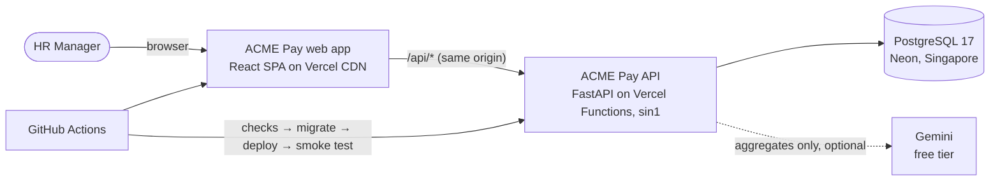
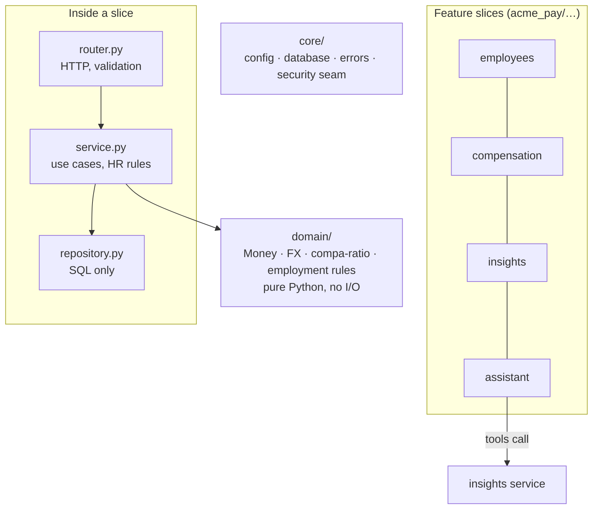
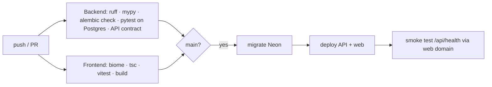

# Architecture

How ACME Pay fits together. The *why* behind each choice is in the [ADRs](adr/); measurements are in [performance.md](performance.md).

## System context



- **One origin.** The web app rewrites `/api/*` to the API (Vite proxy locally, Vercel rewrite in production), so there is no CORS and no API URL in the frontend build.
- **One source of truth.** All data lives in PostgreSQL. The LLM receives aggregates only (ADR 0007).

## Backend: feature slices, dependencies point inward



| Package | Responsibility |
|---|---|
| `domain/` | Pure business rules: `Money`, dated FX conversion, compa-ratio and pay band, salary-change and termination rules. No I/O, tested with property-based tests. |
| `employees/` | Hire, read, update, terminate, search, CSV export. |
| `compensation/` | Salary changes and the append-only history. The salary update and the history entry are written in one transaction. |
| `insights/` | Pay analytics in SQL (pulse, benchmarks, distribution, outliers, pay position, raise preview). |
| `assistant/` | AI analyst: provider-neutral port, Gemini adapter, aggregate-only tools, golden-question evals. |
| `seed/` | Deterministic 10k-employee generator and `COPY` loader. |
| `core/` | Settings, database engine and sessions, RFC 9457 errors, the auth seam (`get_current_actor`). |

Routers hold no logic, services never touch HTTP, and only repositories write SQL. The dashboard, the REST API and the AI analyst all reuse the same services, so each rule has one implementation.

## Frontend: feature folders

```
src/
  app/           router (search params typed and in the URL), shell, ⌘K palette, theme
  features/
    pulse/       home: KPIs, signals, payroll by country and department
    people/      directory, filters, paging, hire dialog, CSV export
    profile/     side panel: pay position, raise preview, history, edit, leave
    benchmarks/  role by country, distribution, outliers   (lazy-loaded)
    assistant/   Ask ACME Pay with evidence cards          (lazy-loaded)
    meta/        dropdown options
  components/    shared: RangeBar, BandBadge, states, form fields; ui/ = shadcn (vendored)
  lib/           typed API client, formatting, hooks
  api/           GENERATED from the backend's OpenAPI schema; CI blocks drift
```

## Key request flows

### Changing a salary
```mermaid
sequenceDiagram
    participant UI as Profile panel
    participant API as FastAPI
    participant DB as PostgreSQL
    UI->>API: POST /employees/{id}/compensation/preview (as HR types)
    API->>DB: peer stats (percentile_cont), latest FX rate
    API-->>UI: new compa-ratio, band, % change, USD cost (nothing saved)
    UI->>API: POST /employees/{id}/compensation
    API->>API: domain rules (active, positive, changed, same currency, after hire)
    API->>DB: UPDATE employees.salary + INSERT compensation_changes (one transaction)
    API-->>UI: history entry; UI refetches every pay view
```

### Asking the AI analyst
```mermaid
sequenceDiagram
    participant UI as Ask page
    participant S as AssistantService
    participant M as Gemini
    participant T as Tools → InsightsService → SQL
    UI->>S: question
    S->>M: question + system rules + 4 tool declarations
    M-->>S: call role_pay_by_country(job_title)
    S->>T: validate arguments, run (aggregates only)
    T-->>S: per-country statistics
    S->>M: tool result (by call id; model turn echoed verbatim)
    M-->>S: short answer
    S-->>UI: answer + evidence (the exact data used)
```

## Data model
`employees` (current salary, status, country, currency) → `compensation_changes` (append-only: previous, new, effective date, reason, author). `fx_rates` are keyed by currency and effective date. Money is `NUMERIC(14,2)` plus an ISO currency code; enums are strings with CHECK constraints. Schema changes go through Alembic, and CI fails if the models and migrations drift.

## Delivery



Production data is seeded by a separate manual workflow (`seed.yml`), never by a deploy.
